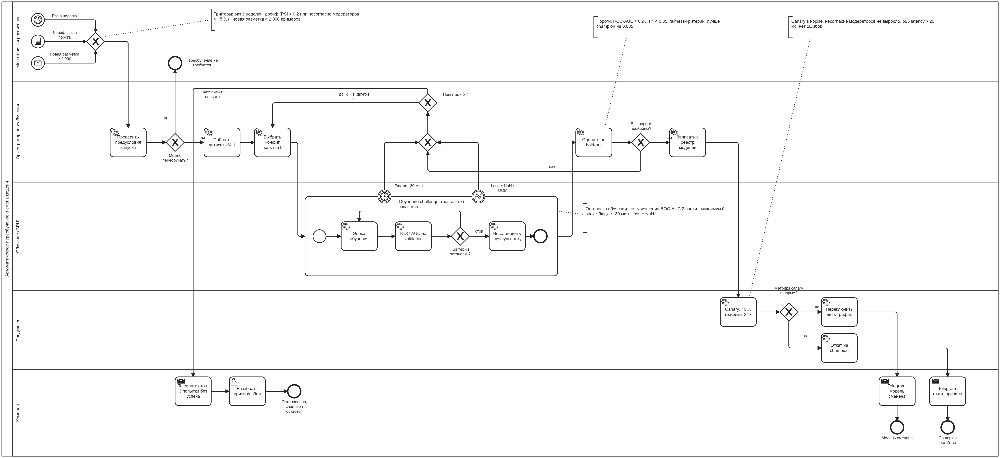

# Автоматическое переобучение и смена модели

BPMN-процесс автоматического переобучения модели `ru-toxicity-detector` и её замены в
продакшене (ДЗ 3): **триггеры**, **процесс переобучения** и **критерии остановки** на трёх
уровнях — внутри обучения, между попытками и при выкатке новой модели.

- Исходник схемы: [`bpmn/auto_retraining.bpmn`](bpmn/auto_retraining.bpmn) — открывается в [bpmn.io](https://demo.bpmn.io/)
- Картинка: [`bpmn/auto_retraining.png`](bpmn/auto_retraining.png)
- Все пороги в одном месте: [`configs/auto_retraining.yaml`](../configs/auto_retraining.yaml)

## Чем отличается от retraining-цикла (ДЗ 2)

| | [Retraining-цикл](RETRAINING.md) (ДЗ 2) | Автоматическое переобучение (ДЗ 3) |
|---|---|---|
| Решение о новой модели | человек (User Task) | автоматические пороги + canary |
| Человек участвует | всегда, до аукциона | только при сбое: разбор после 3 неудачных попыток |
| Защита от плохой модели | проверка человеком | пороги качества, canary на 10 % трафика, автоматический откат |
| Критерии остановки | — | явные на трёх уровнях (ниже) |

## Участники (дорожки)

| Дорожка | Что делает |
|---|---|
| Мониторинг и расписание | запускает процесс по одному из трёх триггеров |
| Оркестратор переобучения | проверяет предусловия, готовит данные, выбирает конфиг, считает попытки, проверяет пороги |
| Обучение (GPU) | подпроцесс обучения с критериями остановки |
| Продакшен | canary-выкатка, переключение трафика или откат |
| Команда | уведомления в Telegram, разбор сбоя человеком |

## Триггеры

Процесс стартует по любому из трёх стартовых событий:

| Триггер | Тип BPMN | Условие |
|---|---|---|
| Расписание | Timer Start Event | раз в неделю (`R/P7D`) |
| Дрейф | Conditional Start Event | PSI распределения скоров > 0.2 или несогласие модераторов > 15 % за 7 дней |
| Новая разметка | Message Start Event | пришла партия разметки модераторов |

**Предусловия запуска** (шлюз «Можно переобучать?»): накоплено не меньше 2 000 новых размеченных
комментариев и с прошлого запуска прошло не меньше 24 часов. Иначе процесс завершается событием
«Переобучение не требуется» — так триггеры не запускают обучение слишком часто и на пустых данных.

## Процесс переобучения

| # | Шаг | Тип BPMN | Дорожка |
|---|---|---|---|
| 1 | Проверить предусловия запуска | Service Task + Exclusive Gateway | Оркестратор |
| 2 | Собрать датасет vN+1 (новая версия данных с sha256) | Service Task | Оркестратор |
| 3 | Выбрать конфиг попытки k (learning rate из сетки) | Service Task | Оркестратор |
| 4 | Обучение challenger: эпоха → ROC-AUC на validation → критерий остановки → лучшая эпоха | Sub-Process | Обучение (GPU) |
| 5 | Оценить на hold-out: качество, fairness, сравнение с champion | Service Task | Оркестратор |
| 6 | Все пороги пройдены? | Exclusive Gateway | Оркестратор |
| 7 | Записать в реестр моделей | Service Task | Оркестратор |
| 8 | Canary: 10 % трафика на 24 часа | Service Task | Продакшен |
| 9 | Метрики canary в норме? → переключить весь трафик или откатиться | Exclusive Gateway | Продакшен |
| 10 | Уведомление в Telegram об итоге | Send Task | Команда |

## Критерии остановки

### 1. Внутри обучения (подпроцесс «Обучение challenger»)

| Критерий | Что происходит |
|---|---|
| ROC-AUC на validation не улучшается 2 эпохи подряд | ранняя остановка, берётся лучшая эпоха |
| Достигнут максимум — 5 эпох | обучение завершается, берётся лучшая эпоха |
| Бюджет времени 30 минут исчерпан | Timer Boundary Event прерывает обучение → неудачная попытка |
| Loss = NaN или нехватка памяти GPU | Error Boundary Event прерывает обучение → неудачная попытка |

### 2. Между попытками

| Критерий | Что происходит |
|---|---|
| Попытка не прошла пороги или была прервана | следующая попытка с другим learning rate: 2e-5 → 1e-5 → 3e-5 |
| Использованы все 3 попытки | **остановка процесса**: уведомление в Telegram, человек разбирает причину, в проде остаётся champion |

### 3. При смене модели

| Критерий | Что происходит |
|---|---|
| Пороги качества: ROC-AUC ≥ 0.95, F1 ≥ 0.85, fairness-критерии из Model Card, AUC выше champion на 0.005 | без этого модель не попадает даже на canary |
| Canary 24 часа в норме: несогласие модераторов не выросло, p95 latency ≤ 20 мс, ошибок нет | весь трафик переключается на новую модель, champion уходит в архив |
| Canary не в норме | **автоматический откат** на champion и уведомление с причиной |

## Уведомления в Telegram

| Событие | Текст сообщения |
|---|---|
| Модель сменена | `✅ Новая модель {version} в продакшене: AUC {auc_new} против {auc_old}, canary 24 ч без проблем.` |
| Откат | `↩️ Откат на {champion_version}: {reason}. Новая модель {version} в архиве.` |
| Остановка | `⛔ Переобучение остановлено: 3 попытки без успеха ({reasons}). Нужен разбор, в проде остаётся {champion_version}.` |

## Роль человека

Процесс полностью автоматический, пока всё идёт штатно: решения принимают пороги и canary.
Человек подключается в одном месте — когда автоматика исчерпала попытки (User Task «Разобрать
причину сбоя»). Это осознанный выбор: модель меняется только при измеримом выигрыше и
безопасной проверке на части трафика, а откат происходит без участия людей.

## Как редактировать схему

1. Открыть [demo.bpmn.io](https://demo.bpmn.io/) и перетащить в окно `bpmn/auto_retraining.bpmn`.
2. Внести изменения и сохранить через **Download BPMN diagram** в тот же файл.
3. Обновить `bpmn/auto_retraining.png`, таблицы в этом документе и пороги в `configs/auto_retraining.yaml`.
