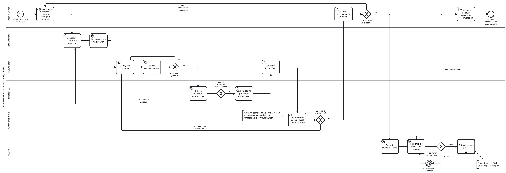

# Жизненный цикл модели

BPMN-процесс жизненного цикла модели `ru-toxicity-detector`: от запроса бизнеса до вывода
модели из эксплуатации, с workflow согласования перед выкаткой.

- Исходник схемы: [`bpmn/model_lifecycle.bpmn`](bpmn/model_lifecycle.bpmn) — открывается в [bpmn.io](https://demo.bpmn.io/)
- Картинка: [`bpmn/model_lifecycle.png`](bpmn/model_lifecycle.png)
- Retraining-цикл (свёрнутый подпроцесс на схеме) подробно описан в [RETRAINING.md](RETRAINING.md) (ДЗ 2)

## Участники (дорожки)

| Дорожка | Кто | Зона ответственности в процессе |
|---|---|---|
| Product Owner | представитель бизнеса | бизнес-задача и критерии успеха, бизнес-согласование, решение о выводе модели |
| Data Engineer | роль «Данные» | сбор и разметка данных, версии датасета |
| ML Engineer | роль «Обучение» | дообучение, оценка метрик, Model Card |
| Fairness / QA | роль «Оценка и fairness» | fairness-анализ, независимое воспроизведение результата |
| Approver | тимлид | техническое ревью и одобрение |
| MLOps | роль «Инфраструктура» | деплой, мониторинг, запуск retraining-цикла |

## Шаги процесса

| # | Шаг | Тип BPMN | Дорожка | Вход | Выход |
|---|---|---|---|---|---|
| 0 | Запрос бизнеса на модель | Message Start Event | Product Owner | проблема модерации | — |
| 1 | Сформулировать бизнес-задачу и критерии успеха | User Task | Product Owner | запрос | целевые метрики и fairness-пороги (см. Model Card) |
| 2 | Собрать и разметить данные | User Task | Data Engineer | критерии, источники данных | размеченный датасет |
| 3 | Версионировать датасет | Service Task | Data Engineer | датасет | версия `vN`, `data/manifest.json` с sha256 |
| 4 | Дообучить модель | Service Task | ML Engineer | датасет `vN`, конфиг | чекпойнт модели |
| 5 | Оценить метрики на test | Service Task | ML Engineer | чекпойнт, test | `reports/metrics.json` |
| 6 | Fairness-анализ по подгруппам | Service Task | Fairness / QA | чекпойнт, test, словарь подгрупп | `reports/fairness.json` |
| 7 | Воспроизвести результат независимо | User Task | Fairness / QA | код, конфиг, версия данных | подтверждение, что метрики совпадают |
| 8 | Обновить Model Card | User Task | ML Engineer | отчёты | новая версия `MODEL_CARD.md` |
| 9 | Техническое ревью Model Card и отчётов | User Task | Approver | Model Card, отчёты | решение «одобрено / замечания» |
| 10 | Бизнес-согласование выкатки | User Task | Product Owner | одобренная Model Card | решение «согласовано / нет» |
| 11 | Деплой: shadow → prod | Service Task | MLOps | одобренная модель | модель в продакшене |
| 12 | Мониторинг качества и дрифта | Service Task | MLOps | поток комментариев, решения модераторов | метрики дрифта |
| 13 | Ежедневная проверка | Timer Intermediate Event | MLOps | — | следующий запуск мониторинга |
| 14 | Retraining-цикл | Call Activity | MLOps | сигнал дрифта | новая модель в проде или прежняя (ДЗ 2) |
| 15 | Решение о выводе модели из эксплуатации | User Task | Product Owner | модель устарела | модель выведена из эксплуатации |

## Шлюзы и условия переходов

| Шлюз | Условие «да» | Если «нет» |
|---|---|---|
| Метрики ≥ целевых? | ROC-AUC ≥ 0.95 и F1 (токсичный) ≥ 0.85 | снова дообучение с другими гиперпараметрами (шаг 4) |
| Fairness-критерии выполнены? | Subgroup/BPSN AUC не ниже общего ROC-AUC более чем на 0.05, разрыв FPR ≤ 0.05, ошибки на шаблонах ≤ 10 % | дополнить данные нейтральными примерами (шаг 2) |
| Одобрено технически? | Approver одобрил Model Card и отчёты | замечания → доработка модели (шаг 4) |
| Согласовано бизнесом? | Product Owner согласовал выкатку | пересмотреть требования (шаг 1) |
| Результат мониторинга | **норма** → ждём следующую ежедневную проверку | **дрифт** → retraining-цикл; **модель устарела** → решение о выводе |

Пороги совпадают с целевыми значениями и fairness-критериями из [Model Card](MODEL_CARD.md).
В `.bpmn` условия записаны как `conditionExpression` на потоках, например
`${roc_auc >= 0.95 && f1_toxic >= 0.85}`.

## Workflow согласования

Перед выкаткой модель проходит два последовательных этапа согласования:

1. **Техническое ревью (Approver, тимлид).** Проверяет Model Card, отчёты по метрикам и
   fairness, факт независимого воспроизведения. Без этого модель не идёт дальше.
2. **Бизнес-согласование (Product Owner).** Проверяет, что модель решает бизнес-задачу и
   ограничения из Model Card приемлемы для продукта.

Оба этапа — User Task: решение принимает человек. Отказ на любом этапе возвращает модель на
доработку с замечаниями, а не завершает процесс. Автоматически пропустить согласование
нельзя: в продакшен попадает только модель, одобренная обоими участниками.

## Как редактировать схему

1. Открыть [demo.bpmn.io](https://demo.bpmn.io/) и перетащить в окно файл `bpmn/model_lifecycle.bpmn`.
2. Внести изменения и сохранить через **Download BPMN diagram** в тот же файл.
3. Обновить картинку `bpmn/model_lifecycle.png` (экспорт SVG в bpmn.io и конвертация в PNG
   или экспорт PNG в Camunda Modeler).
4. Если поменялись шаги или пороги — обновить таблицы в этом документе и Model Card.
