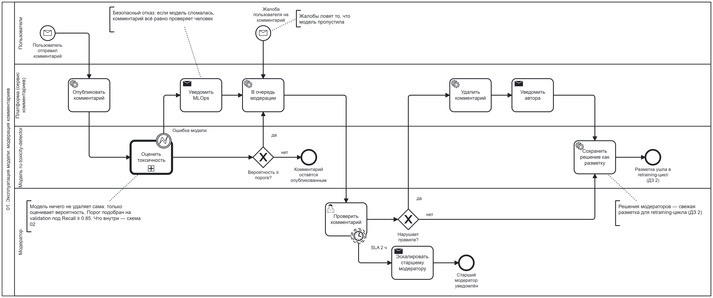
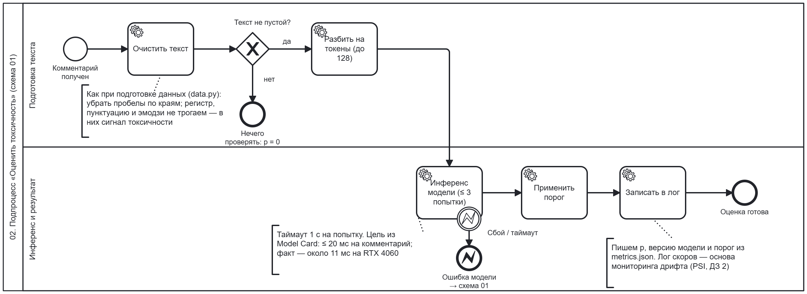

# Эксплуатация модели: модерация комментариев

Две BPMN-схемы того, как модель `ru-toxicity-detector` работает в продукте:

- **01 — бизнес-процесс модерации.** Пользователь пишет комментарий, модель оценивает его,
  подозрительные комментарии попадают к модератору, а решения модераторов становятся новой
  разметкой для переобучения. Отвечает на вопрос «зачем модель бизнесу».
- **02 — подпроцесс «Оценить токсичность».** Техническая детализация одного блока схемы 01:
  что происходит с текстом внутри сервиса модели и что будет, если модель сломалась.

Путь самой модели от запроса бизнеса до вывода из эксплуатации описан в
[LIFECYCLE.md](LIFECYCLE.md).

| Схема | Исходник (открывается в [bpmn.io](https://demo.bpmn.io/)) | Картинка |
|---|---|---|
| 01. Модерация комментариев | [`bpmn/moderation_process.bpmn`](bpmn/moderation_process.bpmn) | [`bpmn/moderation_process.png`](bpmn/moderation_process.png) |
| 02. Подпроцесс «Оценить токсичность» | [`bpmn/scoring_subprocess.bpmn`](bpmn/scoring_subprocess.bpmn) | [`bpmn/scoring_subprocess.png`](bpmn/scoring_subprocess.png) |

## 01. Бизнес-процесс модерации

### Участники (дорожки)

| Дорожка | Кто | Зона ответственности в процессе |
|---|---|---|
| Пользователи | авторы и читатели комментариев | пишут комментарии, жалуются на чужие |
| Платформа | сервис комментариев | публикует, ведёт очередь модерации, удаляет, уведомляет |
| Модель | `ru-toxicity-detector` | оценивает вероятность токсичности, сохраняет разметку |
| Модератор | сотрудник площадки | принимает решение по каждому комментарию из очереди |

### Шаги процесса

| # | Шаг | Тип BPMN | Дорожка | Результат |
|---|---|---|---|---|
| 0 | Пользователь отправил комментарий | Message Start Event | Пользователи | новый комментарий |
| 1 | Опубликовать комментарий | Service Task | Платформа | комментарий виден сразу, модель не задерживает публикацию |
| 2 | Оценить токсичность | Call Activity → схема 02 | Модель | вероятность `p` от 0 до 1 |
| 2a | Ошибка модели | Error Boundary Event | Модель | модель недоступна или упала → шаг 2b |
| 2b | Уведомить MLOps | Send Task | Платформа | дежурный знает о сбое; комментарий идёт в очередь (шаг 4) |
| 3 | Вероятность ≥ порога? | Exclusive Gateway | Модель | нет → комментарий остаётся опубликованным; да → шаг 4 |
| 0a | Жалоба пользователя на комментарий | Message Start Event | Пользователи | второй вход в очередь: то, что модель пропустила |
| 4 | В очередь модерации | Service Task | Платформа | комментарий в очереди, выше вероятность — выше в очереди |
| 5 | Проверить комментарий | User Task | Модератор | решение «нарушает / не нарушает» |
| 5a | SLA 2 ч | Timer Boundary Event (non-interrupting) | Модератор | комментарий ждёт дольше 2 часов → эскалация старшему модератору, проверка продолжается |
| 6 | Нарушает правила? | Exclusive Gateway | Модератор | да → шаги 7–8; нет → шаг 9 |
| 7 | Удалить комментарий | Service Task | Платформа | комментарий скрыт |
| 8 | Уведомить автора | Send Task | Платформа | автор знает, какое правило нарушено |
| 9 | Сохранить решение как разметку | Service Task | Модель | пара «текст — решение модератора» в новой версии датасета |

### Ключевые решения

| Решение | Почему так |
|---|---|
| Модель **ничего не удаляет сама** | модель ошибается, особенно на упоминаниях групп людей (Model Card, раздел 5); удаляет только человек |
| Сначала публикуем, потом проверяем | пользователь не ждёт модель; токсичный комментарий виден недолго, пока модератор его не удалит |
| Порог ниже 0.5 | порог подобран на validation под Recall ≥ 0.85: пропустить оскорбление хуже, чем показать модератору лишний комментарий ([Model Card](MODEL_CARD.md), раздел 3) |
| **Безопасный отказ** при ошибке модели | если модель сломалась, комментарий не пропускается молча, а уходит модератору; MLOps получает уведомление |
| Жалобы — второй вход в очередь | ловят токсичные комментарии, которые модель пропустила |
| SLA 2 часа на проверку | токсичный комментарий не должен висеть долго; таймер не прерывает задачу, а только эскалирует |
| Каждое решение модератора — разметка | модель учится на свежих примерах; когда разметки накопилось достаточно, запускается [retraining-цикл](RETRAINING.md) (ДЗ 2) |

### Бизнес-метрики процесса

| Метрика | Что показывает |
|---|---|
| Доля комментариев, отправленных модератору | нагрузка на модераторов; растёт — модель стала срабатывать чаще (возможен дрифт) |
| Доля удалённых среди отправленных моделью | точность модели глазами бизнеса (precision) |
| Доля жалоб, которые модель не отметила | что модель пропускает (оценка recall) |
| Время от публикации до решения модератора | соблюдение SLA |
| Число ошибок модели за сутки | надёжность сервиса; каждая ошибка добавляет работы модераторам |
| Несогласие модераторов с моделью | триггер retraining-цикла (> 15 % за 7 дней, см. [RETRAINING.md](RETRAINING.md)) |

## 02. Подпроцесс «Оценить токсичность»

Раскрывает блок «Оценить токсичность» (Call Activity) из схемы 01. Две дорожки — два этапа
работы сервиса модели.

| # | Шаг | Тип BPMN | Дорожка | Что делает |
|---|---|---|---|---|
| 0 | Комментарий получен | Start Event | Подготовка текста | — |
| 1 | Очистить текст | Service Task | Подготовка текста | то же, что при подготовке данных (`data.py`): убрать пробелы по краям; регистр, пунктуацию и эмодзи не трогаем — в них сигнал токсичности |
| 2 | Текст не пустой? | Exclusive Gateway | Подготовка текста | нет → нечего проверять, `p = 0`, модель не вызывается |
| 3 | Разбить на токены (до 128) | Service Task | Подготовка текста | токенизатор модели; длинный текст обрезается до 128 токенов, как при обучении |
| 4 | Инференс модели (≤ 3 попытки) | Service Task | Инференс и результат | вероятность `p`; таймаут 1 с на попытку |
| 4a | Сбой / таймаут | Error Boundary Event | Инференс и результат | после 3 неудачных попыток → Error End Event «Ошибка модели»; его ловит граница блока в схеме 01 |
| 5 | Применить порог | Service Task | Инференс и результат | порог своей модели из `reports/<модель>/metrics.json` |
| 6 | Записать в лог | Service Task | Инференс и результат | `p`, версия модели и порог; по этому логу считается PSI для мониторинга дрифта (ДЗ 2) |
| 7 | Оценка готова | End Event | Инференс и результат | `p` и решение «отправить модератору / нет» возвращаются в схему 01 |

Требование к скорости — из [Model Card](MODEL_CARD.md): не больше 20 мс на комментарий;
`ruBert-base-aug` укладывается с запасом (около 11 мс на RTX 4060).

Шаги 1–3 и 5 уже реализованы в коде (`src/toxicity/inference.py`, `src/toxicity/app.py`);
повторные попытки, таймаут и лог скоров — требования к продакшен-сервису.

## Как редактировать схемы

1. Открыть [demo.bpmn.io](https://demo.bpmn.io/) и перетащить в окно нужный `.bpmn` из `bpmn/`.
2. Внести изменения и сохранить через **Download BPMN diagram** в тот же файл.
3. Обновить картинку `.png` с тем же именем.
4. Если поменялись шаги — обновить таблицы в этом документе.
