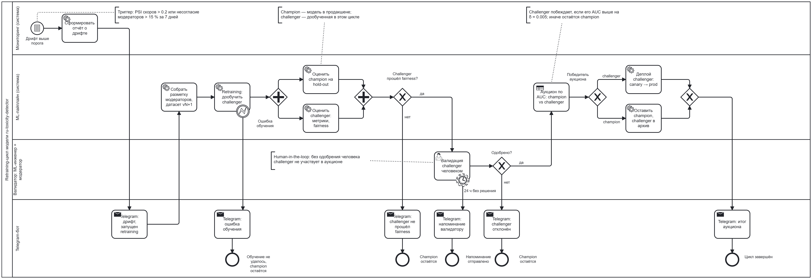

# Retraining-цикл

BPMN-процесс переобучения модели `ru-toxicity-detector` при дрифте: дообучение новой модели,
валидация человеком, аукцион двух моделей по AUC, деплой лучшей и уведомления в Telegram.
В схеме жизненного цикла ([LIFECYCLE.md](LIFECYCLE.md)) этот процесс изображён одним
свёрнутым блоком «Retraining-цикл». Автоматический вариант без обязательной проверки
человеком, с явными критериями остановки — в [AUTO_RETRAINING.md](AUTO_RETRAINING.md) (ДЗ 3).

- Исходник схемы: [`bpmn/retraining_cycle.bpmn`](bpmn/retraining_cycle.bpmn) — открывается в [bpmn.io](https://demo.bpmn.io/)
- Картинка: [`bpmn/retraining_cycle.png`](bpmn/retraining_cycle.png)

## Модели-участники

- **Champion** — модель, которая сейчас работает в продакшене.
- **Challenger** — модель, дообученная в этом цикле на свежих данных (от чекпойнта champion).

## Участники (дорожки)

| Дорожка | Кто или что | Тип |
|---|---|---|
| Мониторинг | сервис мониторинга: считает метрики дрифта | система |
| ML-пайплайн | сбор данных, обучение, оценка, аукцион, деплой | система |
| Валидатор | ML-инженер + модератор | **человек** |
| Telegram-бот | уведомления команде в чат проекта | система |

## Триггер по дрифту

Процесс запускается условным стартовым событием (Conditional Start Event), когда срабатывает
хотя бы одно условие:

| Метрика дрифта | Что показывает | Порог |
|---|---|---|
| PSI распределения скоров модели (эталонный период vs последние 7 дней) | изменилось распределение предсказаний | > 0.2 |
| Доля комментариев, где модератор не согласился с моделью, за 7 дней | модель стала чаще ошибаться | > 15 % |

Условие в `.bpmn`: `${psi_scores > 0.2 || moderator_disagreement_7d > 0.15}`.
Дополнительно в отчёт о дрифте попадает доля слов, неизвестных обучающему словарю, —
признак нового сленга.

## Шаги процесса

| # | Шаг | Тип BPMN | Дорожка | Результат |
|---|---|---|---|---|
| 1 | Дрифт выше порога | Conditional Start Event | Мониторинг | запуск цикла |
| 2 | Сформировать отчёт о дрифте | Service Task | Мониторинг | значения метрик дрифта, примеры комментариев |
| 3 | Telegram: дрифт, запущен retraining | Send Task | Telegram-бот | команда знает о запуске |
| 4 | Собрать разметку модераторов, датасет vN+1 | Service Task | ML-пайплайн | новая версия датасета (см. Model Card, «Версия данных») |
| 5 | Retraining: дообучить challenger | Service Task | ML-пайплайн | чекпойнт challenger |
| 5a | Ошибка обучения | Error Boundary Event | ML-пайплайн | → Telegram: ошибка обучения → конец, champion остаётся |
| 6 | Параллельно: оценить champion и challenger на одном свежем hold-out | Parallel Gateway + 2 Service Task | ML-пайплайн | ROC-AUC обеих моделей, fairness-отчёт challenger |
| 7 | Challenger прошёл fairness? | Exclusive Gateway | ML-пайплайн | нет → Telegram → конец, champion остаётся |
| 8 | **Валидация challenger человеком** | **User Task** | Валидатор | решение «одобрено / отклонено» |
| 8a | 24 ч без решения | Timer Boundary Event (non-interrupting) | Валидатор | Telegram: напоминание, задача остаётся открытой |
| 9 | Одобрено? | Exclusive Gateway | Валидатор | нет → Telegram: challenger отклонён → конец |
| 10 | **Аукцион по AUC** | Business Rule Task | ML-пайплайн | победитель |
| 11 | Победитель аукциона | Exclusive Gateway | ML-пайплайн | challenger → 12, champion → 13 |
| 12 | Деплой challenger: canary → prod | Service Task | ML-пайплайн | новая модель в продакшене, регистрация в Model Registry, старый champion в архиве |
| 13 | Оставить champion, challenger в архив | Service Task | ML-пайплайн | продакшен не меняется |
| 14 | Telegram: итог аукциона | Send Task | Telegram-бот | команда знает результат |

## Аукцион по AUC

Обе модели оцениваются на **одном и том же** свежем hold-out наборе (последняя разметка
модераторов, не участвовавшая в обучении).

| Условие | Победитель |
|---|---|
| `AUC(challenger) − AUC(champion) > δ`, где δ = 0.005 | challenger → деплой |
| иначе | champion остаётся |

Почему нужен запас δ: небольшая разница AUC на hold-out может быть шумом. Замена модели в
продакшене стоит денег и рисков, поэтому challenger должен быть заметно лучше.

К аукциону допускается только challenger, прошедший fairness-критерии (Model Card, раздел 5)
и одобренный валидатором.

## Human-in-the-loop

1. **Данные от людей.** Challenger учится на свежей разметке модераторов, то есть на
   исправленных ошибках модели.
2. **Валидация (User Task).** ML-инженер и модератор смотрят отчёт: метрики обеих моделей,
   fairness по подгруппам, примеры комментариев, где challenger и champion расходятся. Без
   их одобрения challenger не участвует в аукционе и не попадает в продакшен.
3. **Эскалация.** Если решения нет 24 часа, бот присылает напоминание. Таймер
   non-interrupting: задача валидации не отменяется.
4. **Прозрачность.** Каждый исход процесса сопровождается сообщением в Telegram.

## Уведомления в Telegram

| Событие | Текст сообщения |
|---|---|
| Запуск | `🔄 Обнаружен дрифт: PSI = {psi}, несогласие модераторов = {disagreement}. Запущен retraining.` |
| Ошибка обучения | `❌ Retraining упал: {error}. В продакшене остаётся champion {champion_version}.` |
| Fairness не пройден | `⚠️ Challenger {version} не прошёл fairness-проверку: {failed_groups}. Champion остаётся.` |
| Напоминание | `⏰ @{validator}, challenger {version} ждёт валидации больше 24 ч: {report_url}` |
| Отклонён валидатором | `🚫 Challenger {version} отклонён: {reason}. Champion остаётся.` |
| Итог аукциона | `🏁 Аукцион: champion AUC = {auc_champion}, challenger AUC = {auc_challenger}. Победитель: {winner}. Отчёт: {report_url}` |

Токен бота и ID чата хранятся в секретах (`.env`, GitHub Secrets), не в репозитории.

## Как редактировать схему

1. Открыть [demo.bpmn.io](https://demo.bpmn.io/) и перетащить в окно `bpmn/retraining_cycle.bpmn`.
2. Внести изменения и сохранить через **Download BPMN diagram** в тот же файл.
3. Обновить `bpmn/retraining_cycle.png` и таблицы в этом документе.
